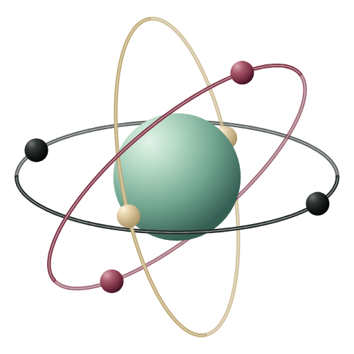
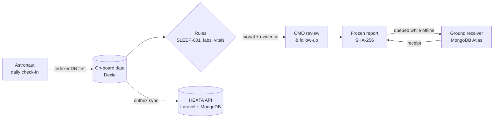

<p align="center">
  
</p>

<h1 align="center">HEXTA</h1>
<p align="center"><strong>Crew health, even when the ground link drops.</strong></p>

<p align="center">
  Team <strong>Synergy 5</strong> · École Centrale Casablanca · NASA Space Apps Challenge 2026 (Casablanca)<br>
  Challenge: <em>Create Health Monitoring Software for Astronauts on Space Missions</em>
</p>

---

## 🌐 Project website

> **Project website:** _coming soon_ <!-- PROJECT_SITE_URL: replace "_coming soon_" with the hosted URL, e.g. [hexta.example.org](https://hexta.example.org) -->
>
> The website presents the project for the jury and the public: the 30-second demo video, the problem, the solution loop, the prototype screens, the 3D body, the NASA data and all sources.

**Demo video (30 s, English captions):** _link to add_ <!-- DEMO_VIDEO_URL -->

> **Simulated crew data. Demo rules are not clinical thresholds. HEXTA is a prototype, not a medical device. Not affiliated with or endorsed by NASA.**

---

## Table of contents

1. [The problem](#the-problem)
2. [Our answer](#our-answer)
3. [Features by role](#features-by-role)
4. [How it works](#how-it-works)
5. [NASA data and references](#nasa-data-and-references)
6. [Architecture](#architecture)
7. [HEXTA API](#hexta-api)
8. [Getting started](#getting-started)
9. [Configuration](#configuration)
10. [Tests](#tests)
11. [Guided demo](#guided-demo)
12. [Project layout](#project-layout)
13. [Safety, privacy and limits](#safety-privacy-and-limits)
14. [Team](#team)
15. [Credits](#credits)

---

## The problem

Imagine you are halfway to Mars. Your commander has barely slept for three nights and says she is fine. On Earth, a doctor would notice. Out there, the nearest doctor is up to twenty minutes away by radio, the link drops often, and the crew medical officer is usually an engineer, not a physician.

Human spaceflight missions are getting longer and more independent from Earth. The challenge, authored by the Brazilian Space Agency, asks for software that helps astronauts assess their own health. It must explain **how** to take each measurement, **why** it matters and **what to do** when a value looks wrong, because astronauts are not doctors. It should also remind the crew to measure, and adapt to a spacecraft, a station or a lunar base.

## Our answer

HEXTA turns a short daily routine into clear, reviewable signals:

1. **A 90-second morning check-in.** Sleep, drowsiness, mood, symptoms and vitals, with guidance for every measurement.
2. **Early warning.** For example, the demo rule `SLEEP-001` flags three consecutive nights under 6 h and notifies the crew medical officer with the evidence: the readings, their source and the rule version.
3. **Guided review on board.** The medical officer sees the trend, follows step-by-step on-board actions, records a decision and can request a follow-up.
4. **Verified reports to Earth.** A frozen, SHA-256-fingerprinted report is queued and sent when the link returns. The ground receiver returns a receipt, and a resend never creates a duplicate.
5. **Offline-first on any device.** Phone, tablet or laptop: everything keeps working during a ground-link outage, then syncs.

## Features by role

| Role | What they can do |
|---|---|
| **Astronaut** | Today view with the next step · guided daily check-in (8 short steps) · spot measurements (blood pressure, SpO₂, temperature, glucose) with method and context · symptom report with an optional photo · personal trends · follow-up requests and answers · Body & Risks screen (2D regions, optional 3D anatomy) |
| **Crew medical officer (CMO)** | Review queue and notifications · crew member file with latest observations, source and quality · step-by-step on-board protocol · review notes and follow-up requests · lab results with reference intervals · individual reports (print / PDF) queued for the ground |
| **Ground (flight surgeon)** | Receives only the reports the CMO chooses to send, each with a receipt and a content fingerprint |

Cross-cutting features:
- **Reminders**: the daily check-in is due at 07:00, can be snoozed for 30 minutes, and missed tasks are marked.
- **Ground link status**: visible on every screen.
- **Workspaces**: the guided demo and the exploration crew are isolated from each other.
- **Light and dark themes.**
- **Accessibility**: works on keyboard and touch.

## How it works



- **Local first.** Every write goes to IndexedDB, so the app never waits for the network.
- **Outbox sync.** `resources/js/data/sync.ts` mirrors check-ins, measurements, lab results, follow-ups, alert reviews and the demo clock to the API. The queue is persistent and retries when the browser is back online.
- **Idempotent ground receiver.** `PUT /api/v1/reports/{uuid}` behaves as follows:
  - same UUID and same content: returns the original receipt;
  - same UUID and different content: returns `409 Conflict`;
  - storage failure: no receipt is ever invented.
- **Traceable rules.** Rules are versioned and tested at their edges, for example 359 vs 360 minutes. Every alert shows the readings behind it.
- **Bounded AI (Claude Vision).** It describes crew photos (skin findings, urine colour) and explains a webcam pulse estimate in plain words. Server rules prevent it from naming a diagnosis, and it can only raise an alert, never lower one.

## NASA data and references

| Source | How HEXTA uses it |
|---|---|
| **NASA Open Science Data Repository (OSDR)**: Inspiration4 crew, OSD-569 (complete blood count), OSD-575 (metabolic panel, cytokines), OSD-656 (urine inflammation). CC0 1.0 | 7,768 real astronaut measurements, imported with a SHA-256 fingerprint per file and served at `/api/v1/nasa/osdr/series`. They are shown as historical context, never mixed with the simulated crew series. |
| **NASA Human Research Program**: the Five Hazards of Human Spaceflight and the Human Research Roadmap risks | Structure the Body & Risks screen and the indicator cards |
| **NASA-STD-3001**, Volumes 1 and 2 | Indicative references: cabin CO₂ limit (V2 6004) and career effective dose limit (V1 4030) |
| **Canadian Space Agency**: Bio-Monitor, CANS | In-flight devices and radiation context for the measurement cards |
| **Scientific literature**: Barger et al. 2014 (sleep in astronauts), Watson et al. 2015 (AASM/SRS sleep consensus), Wang et al. 2017 (remote PPG), Crucian et al. 2016 (in-flight symptoms) | Context for the sleep rule, the webcam pulse and the symptom list |

## Architecture

- **Laravel 13** (PHP ≥ 8.3, tested on 8.4 and 8.5) serves:
  - the single Blade document (`resources/views/app.blade.php`);
  - the compiled assets;
  - the **HEXTA API** (`/api/v1`, OpenAPI docs at `/docs/api`, Swagger UI at `/docs/swagger`).
- **MongoDB Atlas** (or a local MongoDB) holds the API side:
  - versioned observations, check-ins, reminders, notifications and follow-ups;
  - SLEEP-001 alerts and lab results;
  - report snapshots and the ground receiver;
  - NASA OSDR reference data and the knowledge base (Atlas Search when enabled).
  
  Accounts and sessions stay in SQLite.
- **Vite 8 + TypeScript**, with no UI framework: client-side routing over one cached document.
- **Dexie / IndexedDB** stores every on-board record. Each key and each query is isolated by workspace.
- **Service worker** (`public/sw.js`, generated from the Vite manifest at build time): versioned precache, so any internal view reloads offline.
- **three.js** draws the 3D anatomy (HuBMAP reference bodies, CC BY 4.0), loaded only on Body & Risks as a separate, cached chunk.
- **Anthropic Claude (vision)** powers the photo and webcam agent, called from the server through the official PHP SDK.

## HEXTA API

53 routes under `/api/v1`:

| Group | Examples |
|---|---|
| `workspaces/{id}/…` (42 routes) | crew, check-ins, measurements, lab results, reminders, notifications, follow-ups, alerts and reviews, reports and delivery queue, knowledge search, vision agent, demo clock and reset |
| `reports/{uuid}` | idempotent ground receiver (`PUT`) and receipt lookup (`GET`) |
| `nasa/…` | OSDR studies, series and reference data |
| `health` | service and database status |

Artisan commands:

```bash
php artisan hexta:import-nasa-data    # import NASA OSDR measurements and reference data into MongoDB
php artisan hexta:refresh-reminders   # refresh daily check-in reminders, mark missed tasks
php artisan hexta:search-indexes      # create or update the Atlas Search index (knowledge base)
php artisan hexta:atlas-check         # prove the ground receiver on the configured MongoDB: ping, write, read, replay, conflict
```

## Getting started

### Prerequisites

| Tool | Version | Notes |
|---|---|---|
| PHP | 8.4 or 8.5 (`^8.3` required) | extensions: `mongodb` 2.x, pdo_sqlite, mbstring, openssl, tokenizer, xml, ctype, json |
| Composer | 2.x | |
| MongoDB | 7 or 8 locally, or an Atlas cluster | |
| Node.js | 22 LTS (npm 10) | |
| Chromium | any recent version | only for the end-to-end tests |

### Run it

```bash
composer install
cp .env.example .env && php artisan key:generate
php artisan migrate            # SQLite (accounts, sessions) + MongoDB indexes
php artisan db:seed            # NASA OSDR data, knowledge base, demo and explore workspaces in MongoDB
npm install
npm run build                  # tsc --noEmit + vite build + public/sw.js
php artisan serve              # http://127.0.0.1:8000
```

For hot reload, run `npm run dev` next to `php artisan serve`. The service worker registers **only with the production build**, so test offline behaviour against `npm run build` and `php artisan serve` (same origin).

<details>
<summary>Docker equivalent</summary>

```bash
docker run --rm -u $(id -u):$(id -g) -v $PWD:/app -w /app composer:2 composer install
./scripts-node.sh npm install
./scripts-node.sh npm run build
docker run --rm -u $(id -u):$(id -g) -v $PWD:/app -w /app composer:2 php artisan migrate
docker run -d --name hexta-serve -u $(id -u):$(id -g) --network host -v $PWD:/app -w /app composer:2 php artisan serve --host=127.0.0.1 --port=8000
```
</details>

## Configuration

Main variables in `.env` (see `.env.example`):

| Variable | Purpose |
|---|---|
| `MONGODB_URI`, `MONGODB_DATABASE` | MongoDB Atlas or local connection (default `hexta_demo`) |
| `MONGODB_TIMEOUT_MS` | server selection timeout |
| `HEXTA_RECEIVER_NAME` | label shown on ground receipts |
| `HEXTA_ATLAS_SEARCH` | `true` to use Atlas Search for the knowledge base |
| `ANTHROPIC_API_KEY` | key for the vision agent (leave empty to disable it) |
| `HEXTA_AGENT_MODEL`, `HEXTA_AGENT_EFFORT` | model and effort used by the vision agent |

Never commit `.env` or any API key.

## Tests

```bash
npm test                 # Vitest: domain rules (sleep, reminders, labs, symptoms) + IndexedDB data layer
php artisan test         # PHPUnit: API, ground receiver, sync, NASA import, alerts, vision guardrails, rules
npx playwright test      # E2E at 1440 px and 390 px against http://127.0.0.1:8000
```

The acceptance matrix (M01–M16 / V01–V12) and open gaps are in [`docs/ACCEPTANCE.md`](docs/ACCEPTANCE.md). Design decisions are in [`docs/DESIGN_DECISIONS.md`](docs/DESIGN_DECISIONS.md). Asset rights are in [`docs/ASSET_CREDITS.md`](docs/ASSET_CREDITS.md).

## Guided demo

The guided demo runs on a fictional lunar-orbit crew (`QN-LO-03`) on **Day 142**, with the ground link offline:

1. From the home page, choose **Guided demo** and the **Astronaut** role (Cdr K. Moreau).
2. Open **Daily check-in**. The sleep draft (5 h 12 min) is pre-filled. Go through the steps and save.
3. You get "Saved on this device", then **Sleep trend needs review · Demo rule**, with Day 140 5 h 36, Day 141 5 h 24 and Day 142 5 h 12.
4. Switch to the **CMO** role (Dr A. Haddad). The bell shows 1 unread: open the notification, review the evidence, **Record review** and request a follow-up if needed.
5. In **Reports**, generate the Moreau report and choose **Queue for ground**. When the link is available it moves through *Queued*, *Sending* and *Received*, with a receipt from the MongoDB Atlas ground receiver.

**Explore app** is an independent fictional crew (`QN-EX-01`) on the real clock.

## Project layout

```
app/Services/                 domain services: alerts, sleep rule, labs, reminders, reports, ground receiver, NASA data, vision agent
app/Http/Controllers/Api/V1/  HEXTA API controllers (workspaces, reports, NASA, health)
app/Console/Commands/         hexta:* Artisan commands
database/migrations/          SQLite tables + MongoDB indexes
resources/js/domain/          pure, offline rules: SLEEP-001, reminders, labs, measurements, queue
resources/js/data/            Dexie schema, transactions (repo.ts) and API sync outbox (sync.ts)
resources/js/demo/            versioned demo dataset, workspace config, seeding
resources/js/features/        today, check-in, measurements, trends, body-risks (+ lazy 3D), follow-up, crew, notifications, reports, help, settings
resources/sw/sw.template.js   service worker template (vite.config.ts writes public/sw.js)
tools/build-anatomy-hra.mjs   builds the female / male anatomy GLBs from the HuBMAP reference bodies
tests/js · tests/Feature · tests/Unit · tests/e2e
```

## Safety, privacy and limits

- HEXTA is a **prototype with simulated crew data**. It does not diagnose or prescribe.
- Alerts come from **labelled demo rules** and indicative public reference values. They prompt a review by the crew medical officer and do not replace a validated mission medical policy.
- The vision agent cannot name a diagnosis or lower an alert. Its output is always reviewed by a human.
- Photos attached to symptom reports stay on the device (IndexedDB) and are never sent in a ground report.
- Demo data and account data are kept separate.

## Team

**Synergy 5**, École Centrale Casablanca:

- BARA Solène
- AWAGA Daniel
- KPANKOU Auguste
- DANSOU René
- NOUDEGBESSI Pierre-Claver
- HOUNKPETEHOU Marius

## Credits

- NASA OSDR datasets (CC0 1.0), NASA Human Research Program, NASA-STD-3001, NASA images (courtesy of NASA). HEXTA is not affiliated with or endorsed by NASA.
- 3D anatomy: HuBMAP Human Reference Atlas, 3D Reference Object Library (CC BY 4.0). Body shell: Innerscene (CC0 1.0).
- Full asset list and licences: [`docs/ASSET_CREDITS.md`](docs/ASSET_CREDITS.md).
