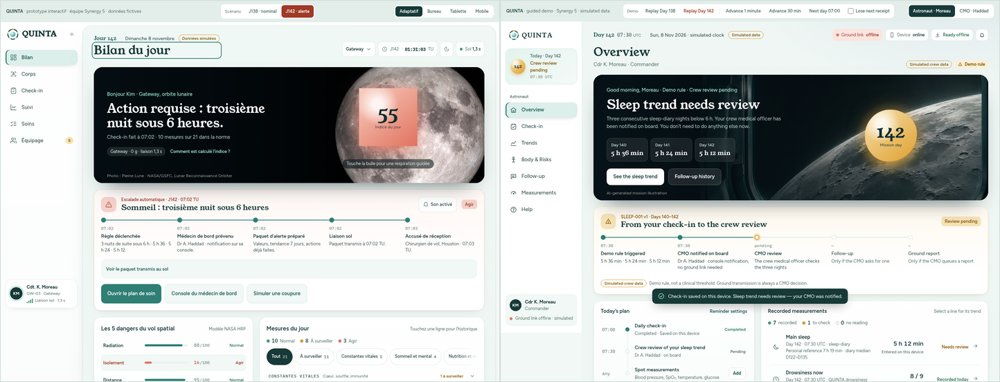
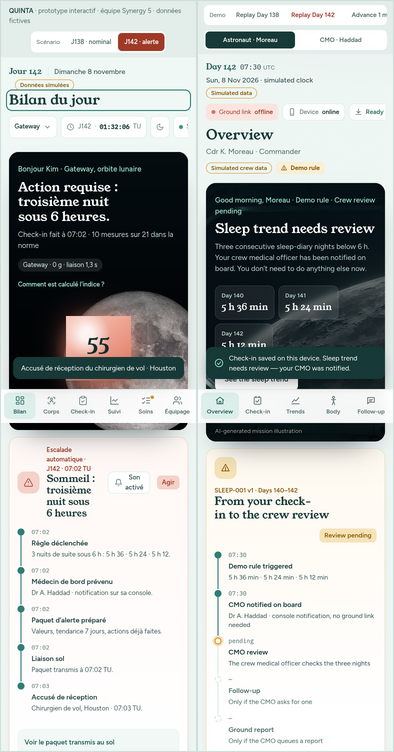
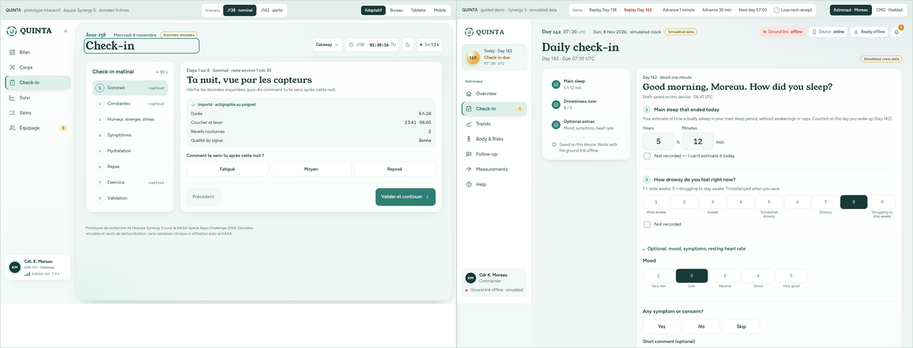
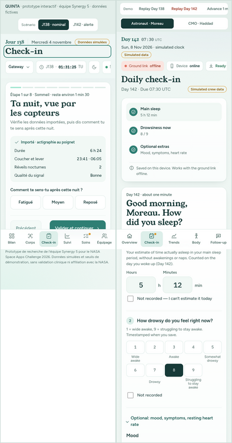
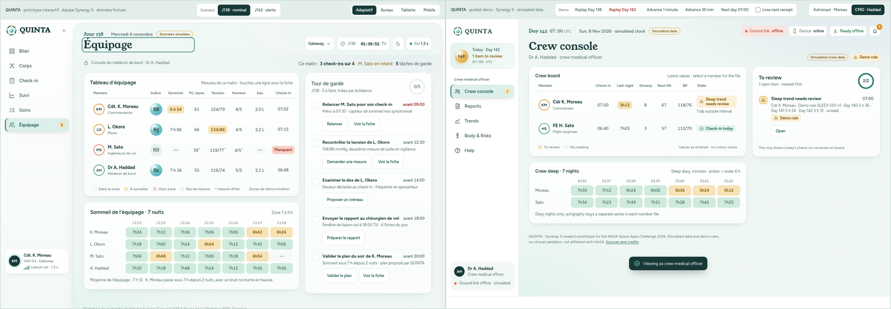
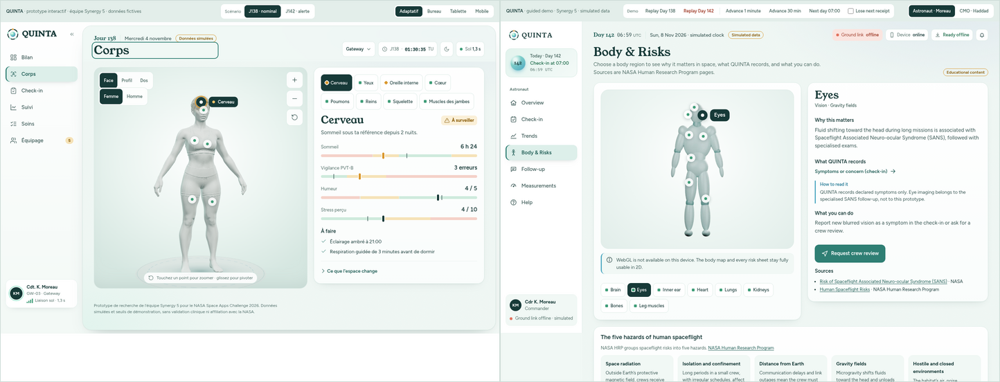

# Design decisions

## Direction: the QUINTA-lot4 mockup, applied as-is

First pass (14 Nov): two directions explored ("Mission console" vs "Next action first"); the second was built on the kit preview palette.
**Second pass (team request): restyle as close as possible to the team's own mockup `reference/QUINTA-lot4`.** The tokens and components are now the mockup's:

| Area | Taken from the mockup |
|---|---|
| Tokens | Theme "Lagon": page `#E3EEEA`, bg `#F1F8F5`, ink `#173A38`, lagon `#2F7F74` / `#215F57`, menthe `#9EE6CF`, ciel `#4FA9C2`, écume `#DDEFEA`, ok / amber / coral state pairs, v18 elevations (`--e1`, `--e3`), ambient radial light and grain behind the main area |
| Type | Young Serif for titles, hero, orb, key figures; Figtree 15 px body, tabular figures for values; IBM Plex Mono only for clocks and times (mockup v18 rule) |
| Frame | Preview bar outside the app (demo scenario + role), 236 px white sidebar with the "Today" card and breathing orb, `sb-item` navigation with écume active state, crew/link footer card; icon rail at 700–1099 px; bottom tab bar under 700 px |
| Header | `Day 142 · time UTC │ date │ Simulated data` eyebrow, chips at the right (ground link, device, offline cache, reports, bell), 34 px serif title |
| Overview | Dark hero with porthole image, menthe kicker, white serif headline, light + glass buttons and the orb; "Escalade" timeline card; schedule timeline (`.sl`); indicator rows (`.ind`); five hazards list |
| Check-in | `ci-grid` with stepper on the left, `q-h` serif question, ink-filled scale buttons, three-way Yes/No/Skip, done card |
| CMO | `gd` layout: crew board with ringed avatars and cells, 7-night sleep grid, "To review" watch list with ring |
| Body | Radial viewer, white-dot markers with ink tag, organ chips, serif organ heading, ciel-bordered note |
| Reminder | `remind` card with haloed icon, actions and × dismiss |

**Colour code (fourth pass, team request):** the mockup's three levels are back: green *in zone*, amber *to watch*, coral *out of zone / to review*. They colour the orb, the state chips, the crew board cells, the 7-night sleep grid and the avatar rings. Sleep uses 7 h and 6 h bounds, labelled "Demo zones" as in the mockup; a state is always written as well as coloured.

**Deliberate differences, required by cadrage v5.2:** the orb shows the mission day instead of the "Indice du jour"; no composite score (the hazards card shows coverage bars instead of the mockup's 0–100 gauges); the escalation timeline shows CMO decisions instead of an automatic transmission to the flight surgeon; the hero uses the kit's AI-generated porthole (rights documented) instead of the mockup's NASA photos (origin not documented in the kit); English copy.

## Third pass: signature interactions

Built on the mockup's language, without changing data or rules. No new dependency: native View Transitions, Web Animations and SVG.

| Feature | What it does | From the mockup |
|---|---|---|
| Mission guide | Demo only. Five steps read from real state (reminder, check-in, crew review, report, receipt); the current step is one button that performs or opens the next action. The whole scenario can be played with that button alone. Can be hidden. | Scenario bar, extended |
| Soft night | Warm dark theme, toggled in the header or the palette, remembered on the device | "Nuit douce" |
| Breathing orb | Tap the hero orb: three guided breaths (4 s in, 6 s out) with a live read-out | "Respirer avec la bulle" |
| Living porthole | Twinkling starfield and pointer parallax behind the hero | Hero photo |
| Sleep dial | The check-in shows the night as an arc that follows the inputs, with −15 / +15 min buttons. Inputs stay the accessible path | Short guided entry |
| Trend curve | Monotone smooth line (never overshoots a recorded value), gradient area, draw-in on arrival, hover and keyboard read-out with crosshair | Smooth "Suivi" chart |
| Command palette | Ctrl/⌘ K: jump to any screen or action, switch role, cut the link, toggle night | — |
| Screen transitions | Short cross-fade and rise between views; sidebar and preview bar stay still | View entrance |

All motion stops with `prefers-reduced-motion`. Captures: `screenshots/desktop-1440/13-soft-night.png`, `14-command-palette.png`.

## Fourth pass: anatomy in 3D, colour code, symptom reports

- **Body & Risks** opens on a rotating 3D anatomy (female or male, HuBMAP reference bodies, CC BY 4.0): translucent skin, organs, vessels, optional skeleton and digestive layers, Front / Side / Back, zoom to the selected region, Play / Pause. The 2D map and the region list remain the fallback and the accessible path ("Back to 2D" is remembered).
- **Palette audit**: tokens were already the mockup's; six hard-coded colours and about ten spacing and type details were aligned (`tools/compare-styles.mjs` compares computed styles view by view).
- **Report a symptom**: description, body area, time noticed and an optional photo, saved on the device (works offline), submitted for onboard review, reviewed by the CMO with notes or a request for more information; feedback comes back in Follow-up. Report, attachment and review thread are separate records with stable IDs so a later image-analysis step can attach a suggestion for CMO validation. Photos never leave IndexedDB.

## Fifth pass: UX audit, mockup header, Space Apps criteria

Audit done twice on every screen at 1440 px and 390 px: as a senior UX reviewer (Nielsen heuristics, required states), then as the astronaut doing the daily loop one-handed on a tablet or phone.

| Finding | Severity | Fix |
|---|---|---|
| Phone tab bar showed 5 of 7 screens: Measurements and Help could not be reached | Critical | Four most used tabs plus "More", which opens the screen and action list |
| On a phone the next action sat below 500 px of header | High | Title and day on one block, date hidden, guide reduced to one line and one button; the hero is in the first screen |
| "8 in zone" while the latest night was out of zone; state written only as an age | High | Counters follow the three levels; sleep shows the zone word and the age |
| Page title below the guide, not in the header as in the mockup | Medium | Title in the mission header under the day line, chips on the right; the guide sits above |
| Trend summary was one long serif sentence repeating the tiles | Medium | Value first, then one plain sentence ("1 h 55 min below your personal reference") |
| Five hazards looked identical (same icon) and had no link to the data | Medium | One icon per hazard and a coverage bar: indicators recorded today, stated as not a risk score |
| Follow-up opened on an empty half-page card; two "Temperature" lines with no method | Medium | Empty state that explains what will appear; method shown on each reading |
| Temperature row switched between two series recorded at the same minute | Medium | Crew-entered reading wins over the simulated sensor |
| Small touch targets (34 px chips and buttons) | Medium | 44 px on touch devices; larger checkboxes; "Save check-in" stays reachable at the bottom on a phone |
| "Ctrl K" shown on touch devices | Low | Label "Go to" on touch devices |
| Help credits still named the old mannequin | Low | HuBMAP credit; new "NASA resources in QUINTA" section |

Space Apps 2026 rules taken into account (Judging & Awards Guide, Project Submission Guide): the AI-generated porthole is labelled "AI-generated image" on screen; no NASA logo or mission identifier; English only; every external resource is listed in Help; the NASA resources and their use are stated for the Relevance criterion.

## Kept from the mockup (QUINTA-lot4)

- **Mission identity**: QUINTA logo and orb, mission strip with day, UTC clock and ground-link chip, *Simulated data* tag, Young Serif headings, IBM Plex Mono for values and times, Figtree for labels.
- **Role navigation**: sidebar on desktop, bottom tab bar on mobile, CMO console with a member list and a member file.
- **Risk sheet linked to a body region**: the mannequin with region markers and a sheet per region, plus the five NASA HRP hazards.
- **Today's plan**, the reminder banner with "in 30 min" (now a persistent snooze), the "why this alert?" explanation, the alert timeline idea, and the crew sleep strip (7 nights) in the CMO file.
- **Check-in** as a short guided entry ending in a clear confirmation.

## Transformed

| Mockup | Now | Why (cadrage v5.2) |
|---|---|---|
| Global "Indice du jour 55/86" score and Normal/Monitor/Act colour bands | Removed. Each indicator shows its value, time, method, source and a stated reason (Recorded today · N days old · No reading · Check measurement · Needs review) | p.4, p.13: no composite score without a validated policy |
| Automatic escalation to the flight surgeon, "packet sent to ground at 07:02" | The CMO reviews on board. **Queuing a report is an explicit CMO decision**. The queue shows Queued, Sending, Received and Retry available, and the receipt names its receiver | p.7, p.12, p.17 |
| Actigraphy sleep imported into the check-in, rule "< 7 h two nights" | Sleep diary entered by the astronaut. **SLEEP-001 v1**: three consecutive nights < 360 min, labelled "Demo rule", demo only. Actigraphy is a separate series and never counts | p.8, p.11, p.18 |
| Mood/energy pad, 0–10 stress, 8 steps | Two required questions (sleep, drowsiness 1–9 with anchors), with "Not recorded" and confirmed zero. Mood 1–5, symptoms Yes/No/Skip and resting HR under *Optional* | p.8 |
| Toast-only confirmations in the crew console | Every action is persisted (review, follow-up request, lab result, report). The toast complements a state that stays visible and is announced in a status region | p.4, p.6 |
| Environment switcher (ISS/Gateway/Rover/Mars), night mode, gamification, team goals | Left out: extensions, not part of the MUST loop | p.3, p.4 |
| Female 3D mesh (unconfirmed licence, 5.9 MB) shown first | Female and male HuBMAP reference bodies (CC BY 4.0, 1.4 MB each) with organs, loaded on demand. Full HTML region list and 2D map stay available | p.19, kit RESSOURCES_3D |
| French UI | English UI, reports and help | p.2 |

## Intended effect

- **Astronaut**: in one glance and one tap, what is due, why, and the button. Reassurance that it is "Saved on this device" even with the ground link offline.
- **CMO**: one "To review" list (sleep trend, review requested, follow-up completed, report retry) that opens straight on the evidence. The alert card shows the three dated nights, their method and source, and the drowsiness/mood context.
- **Jury**: the same screens and services in both workspaces. Demo controls sit in a dashed amber bar marked "only affect the guided demo". Simulation labels stay next to the data, the rule and the receipt.

## Status consistency

The mission strip on every view shows: **Ground link** (simulated, toggle), **Device online/offline** (browser), **Ready offline** (service worker cache), and a **Reports** chip with queue states from the same IndexedDB rows as the Reports view and the Follow-up history. The bell counts unread notifications for the current role.

## Accessibility

Visible focus ring (3 px), skip link, one `h1` per view focused on navigation, labelled fields with errors next to them, radio groups for the scales, Escape and focus trap in the guide (`<dialog>`), and a status region for confirmations. Text plus icon for every state (never colour alone). Chart markers use distinct shapes, hollow markers mean "check measurement", and a data table mirrors the chart. `prefers-reduced-motion` disables transitions and the automatic heart beat. The 3D canvas is `aria-hidden`; the 2D list is the accessible path, with arrow-key navigation.

## Before / after

Before is the original mockup (left), after is QUINTA (right), at 1440 px and 390 px.

| View | Capture |
|---|---|
| Overview Day 142 after saving (1440) |  |
| Overview Day 142 (390) |  |
| Check-in (1440) |  |
| Check-in (390) |  |
| CMO console (1440) |  |
| Body & Risks (1440) |  |

All full-page captures: `docs/screenshots/before/`, `docs/screenshots/desktop-1440/`, `docs/screenshots/mobile-390/`, `docs/screenshots/offline-queued-1440.png`.
