# Modifications front-end — branche `feat/frontend-ux`

Point de départ : `main` au commit `7bb5f44` (« preserve complete local QUINTA before role redesign »).
Référence visuelle : la maquette **HEXTA-lot4** (même interface que QUINTA-lot4, avec le nouveau logo animé).
Toutes les captures sont dans [`docs/screenshots/hexta-frontend/`](screenshots/hexta-frontend/).

**Aucune règle métier, donnée ou logique de stockage n'a changé** (`resources/js/domain/`, `resources/js/data/db.ts`, back-end Laravel intacts). Les changements portent sur l'habillage, la navigation et l'ergonomie.

---

## 1. Renommage QUINTA → HEXTA et nouveau logo

- Tous les textes visibles disent **HEXTA** : barre latérale, titres d'onglet, page d'accueil, Help, check-in, Body & Risks, rapports, écran de chargement, manifest de l'app.
- Nouveaux fichiers de marque dans `public/assets/brand/` :
  - `hexta-logo.svg` — logo empilé (emblème + mot HEXTA), recadré pour rester lisible en petit. Utilisé sur l'accueil, l'écran de chargement et l'en-tête des rapports.
  - `hexta-symbole.svg` — emblème seul.
  - `hexta-icone-app-180.png`, `hexta-symbole-512.png`, `favicon-32.png` — icônes générées depuis le SVG de la maquette.
- **Volontairement inchangé** (identifiants internes) : nom de la base IndexedDB `quinta`, clés `localStorage` `quinta.*`, schéma de rapport `quinta-report/1` (contrat avec le récepteur Laravel), noms de cache du service worker, classe `QuintaDb`. Les renommer effacerait les données locales et casserait le récepteur.
- Les anciens fichiers `quinta-*` sont laissés dans `public/assets/brand/` (plus utilisés par l'app, encore cités par la doc).

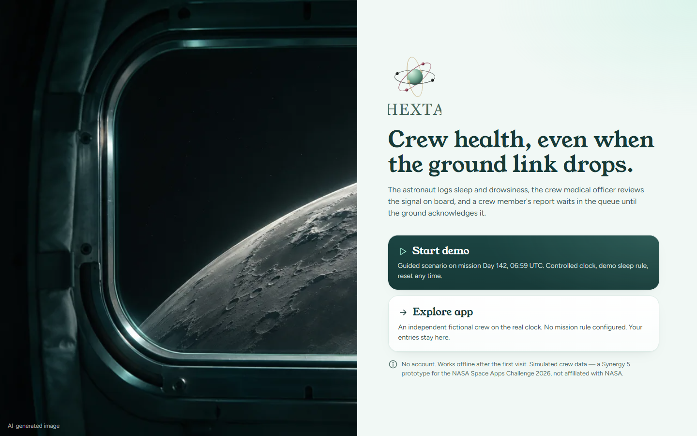

## 2. Logo animé dans la barre latérale

Repris de la maquette HEXTA (`HexEmblem`), porté en TypeScript dans **`resources/js/components/brand.ts`** (nouveau fichier).

- Sphère fixe, trois orbites 3D et deux satellites par orbite, mêmes couleurs que la maquette.
- **Le logo est un bouton** : il replie / déplie la barre latérale en rail d'icônes (préférence `hexta.rail`). Les orbites font un tour complet pendant l'animation.
- Les satellites avancent quand on fait défiler la page et reculent quand on remonte.
- Aucun mouvement avec `prefers-reduced-motion`.
- Le rail ne s'applique qu'à partir de 700 px : sur téléphone, la mise en page mobile (une colonne + barre d'onglets) l'emporte toujours.

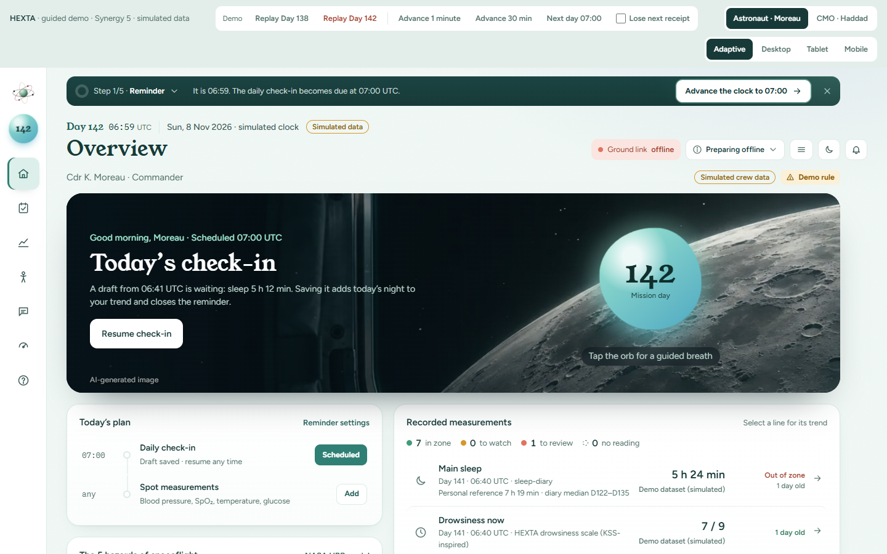

## 3. Sélecteur d'affichage (outil de travail)

Dans la barre de prévisualisation : **Adaptive / Desktop / Tablet / Mobile**, comme dans la maquette.

- Desktop 1280×800, Tablet 834×1000, Mobile 390×800 (tailles de la maquette).
- Hors « Adaptive », l'app est affichée **dans une iframe à la taille de l'appareil** : les media queries, la barre d'onglets mobile et les tailles tactiles sont les vraies.
- Les commandes de la barre (rôle, scénario, horloge, liaison sol) pilotent l'app dans le cadre (messages `postMessage` entre la page et l'iframe). Dans ce mode, seule l'app encadrée traite les rappels et la file des rapports.
- Préférence mémorisée (`hexta.viewport`). Outil de travail : on pourra le retirer plus tard.

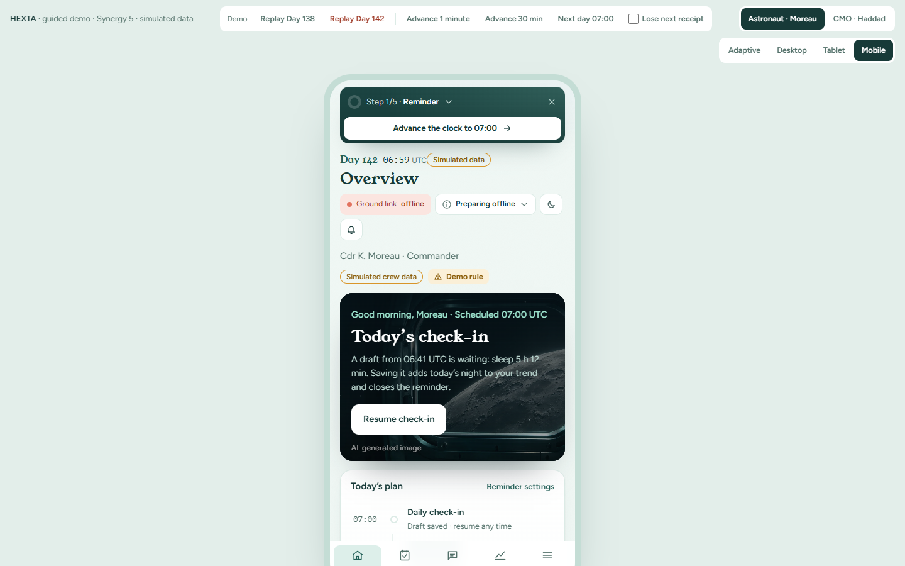
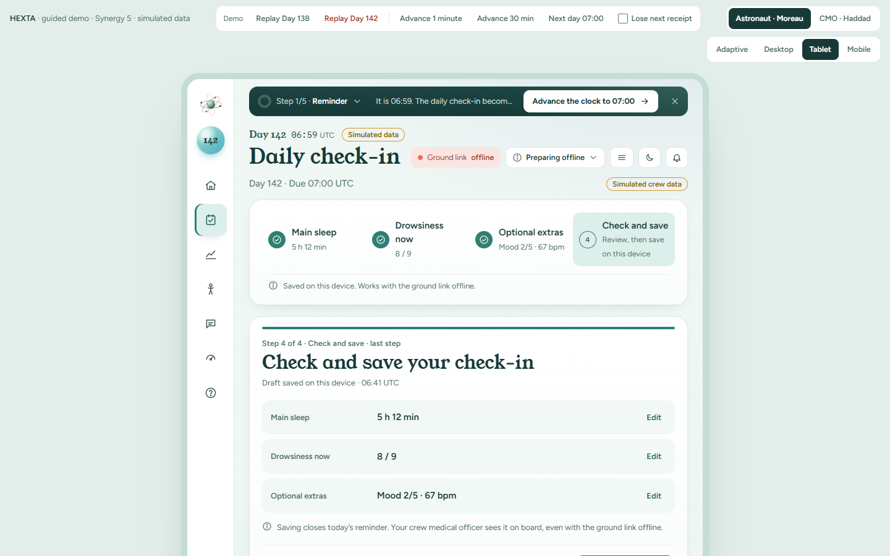

## 4. En-tête allégé

Avant : 5 bandes empilées (~300 px) avant le contenu. Maintenant :

- **Guide de démo sur une ligne** : anneau de progression, « Step 1/5 · Reminder », la phrase et le bouton d'action. Un clic sur « Step 1/5 » déroule les 5 étapes.
- **Pastilles d'état regroupées** : Ground link et la cloche restent visibles. Device, cache hors ligne et rapports sol sont dans **une seule pastille** qui dit « All set » ou nomme le problème (« Device offline », « 1 report to retry », « Preparing offline ») ; un clic ouvre le détail.
- **Rappel non dupliqué sur l'Overview** : la carte d'accueil dit déjà « Daily check-in is due ». Le bandeau reste sur les autres écrans.
- Le bouton « Go to » (Ctrl K) n'affiche plus que l'icône ; masqué sur téléphone (le bouton « More » de la barre d'onglets fait la même chose).
- Menus déroulants : un seul ouvert à la fois, fermeture au clic extérieur ou avec Échap.

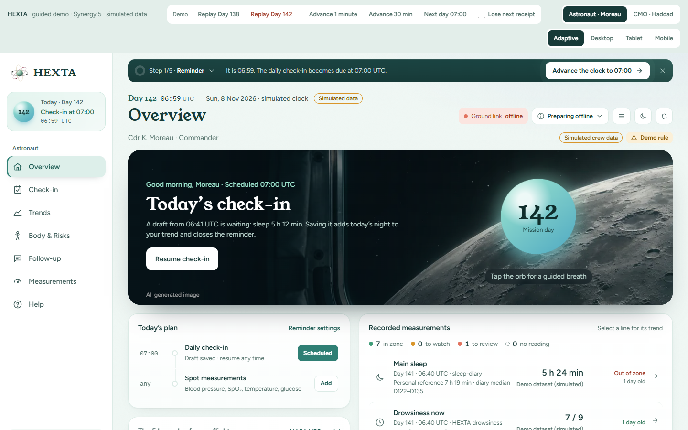
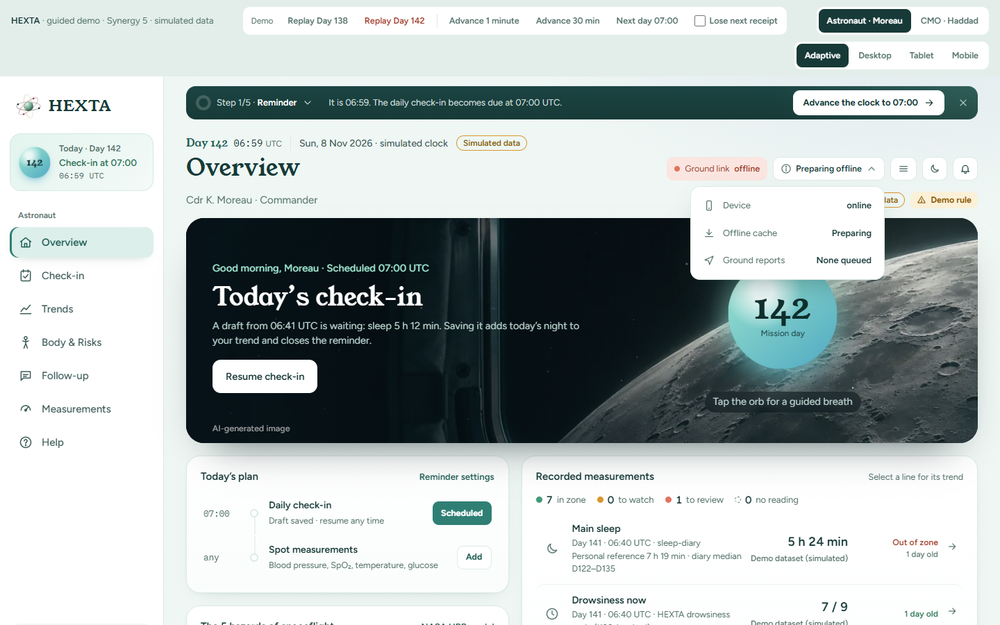
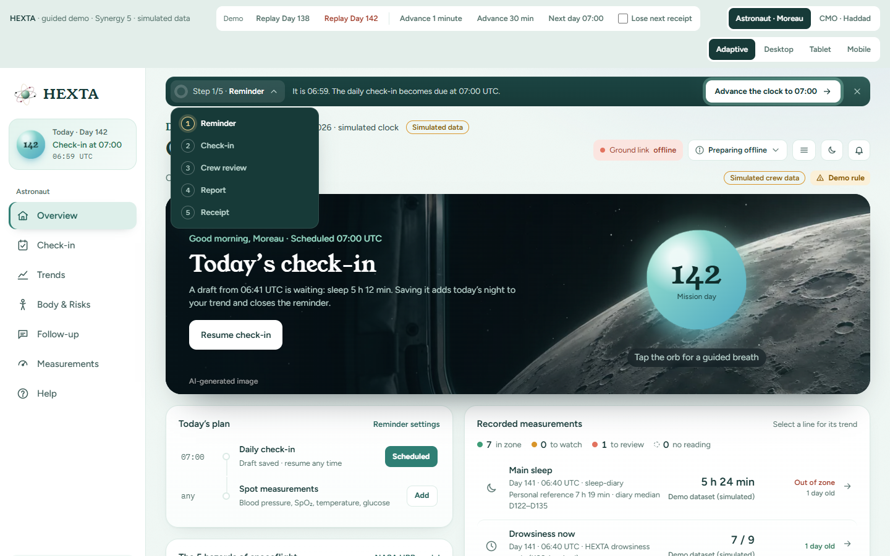

## 5. Check-in pas à pas

Une question par écran, comme la maquette :

1. **Main sleep** (cadran, heures/minutes, ±15 min, « Not recorded »)
2. **Drowsiness now** (échelle 1–9)
3. **Optional extras** (humeur, symptômes, fréquence cardiaque, lien mesures ponctuelles)
4. **Check and save** (récapitulatif avec « Edit » par ligne ; réponse obligatoire manquante en ambre)

- Desktop : liste des étapes à gauche, cliquable, avec la réponse sous chaque étape. Mobile : barre de progression et boutons fixés en bas.
- « Continue » valide l'étape en cours ; Entrée passe à l'étape suivante. Un enregistrement en erreur ramène à l'étape concernée.
- **Démo inchangée en rapidité** : si le brouillon contient déjà sommeil et somnolence (cas de la démo guidée), on arrive directement sur « Check and save » → un clic sur « Save check-in ». Un bouton « Save now » est aussi proposé sur chaque étape dès que les deux réponses obligatoires sont là.
- Même formulaire, mêmes champs, même brouillon automatique : seul l'affichage est découpé.

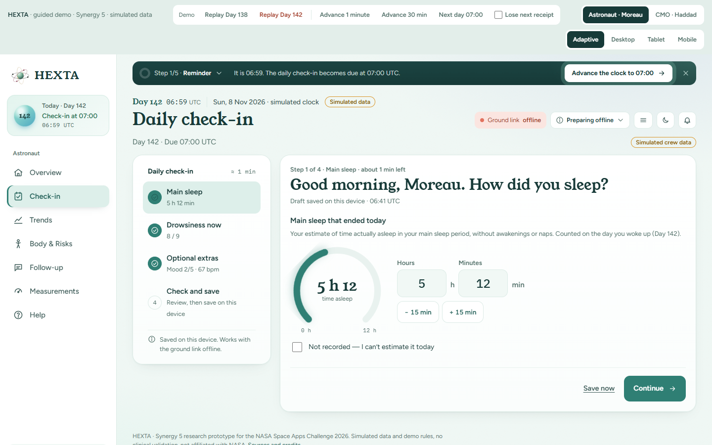
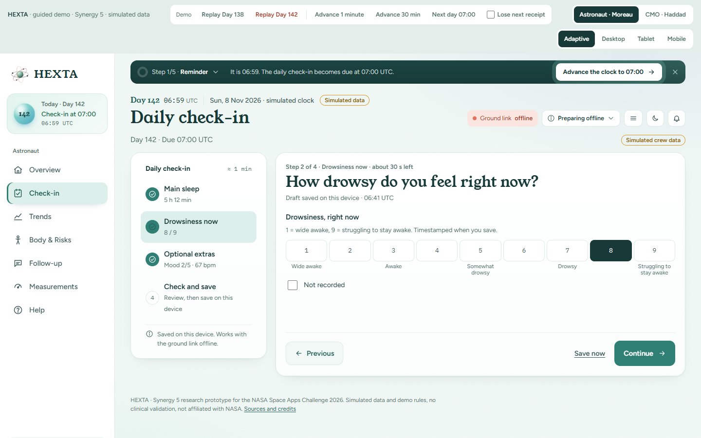
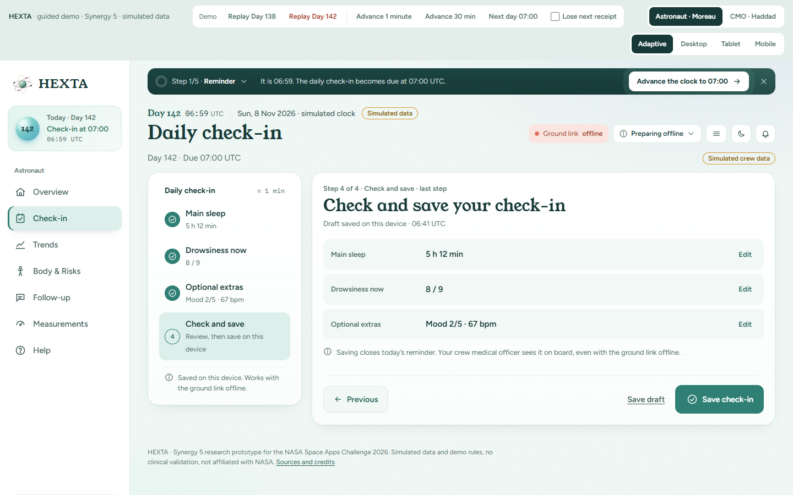

## 6. Mobile

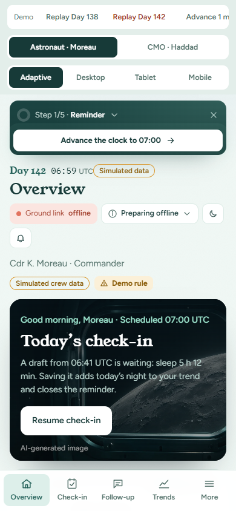
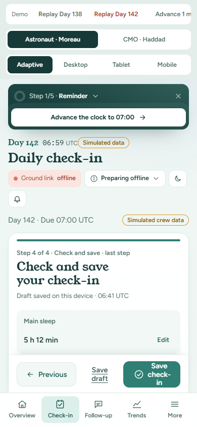

---

## Fichiers touchés

| Fichier | Changement |
|---|---|
| `resources/js/components/brand.ts` | **Nouveau** — logo animé |
| `resources/js/components/shell.ts` | Logo-bouton, barre de prévisualisation (exportée `previewBar()`, sélecteur d'affichage), guide sur une ligne, pastille d'état `statusMenu()`, bandeau masqué sur l'Overview |
| `resources/js/main.ts` | Mode aperçu dans une iframe (`isDeviceMode`, `renderDevice`, messages), actions `viewport` et `rail-toggle`, défilement → logo, fermeture des menus déroulants |
| `resources/js/state.ts` | `viewport`, `rail`, `VIEWPORT_SIZE`, `EMBEDDED`, `syncPrefs()` |
| `resources/js/features/check-in/checkin.ts` | Parcours en 4 étapes |
| `resources/js/components/icons.ts` | Icône `chev` |
| `resources/css/app.css` | Logo, rail, cadre d'appareil, en-tête allégé, check-in par étapes (blocs ajoutés en fin de fichier) |
| `resources/views/app.blade.php`, `public/manifest.webmanifest`, `vite.config.ts`, `resources/sw/sw.template.js` | Nom et icônes HEXTA |
| Autres `features/*.ts`, `data/repo.ts`, `demo/seed.ts` | Textes QUINTA → HEXTA uniquement |

## Pour la branche « rôles » : zones de conflit probables

- **`shell.ts`** : `navItems()` (liste par rôle) n'a **pas** été modifié. Ont changé autour : le haut de la barre latérale (logo), `previewBar()` (maintenant `async`, exportée, sans paramètres, contient les boutons de rôle), la ligne de pastilles et `coach()`.
- **`main.ts`** : l'action `role` n'a pas changé, mais le rôle est relu via `syncPrefs()` (clé `quinta.role`) quand l'app tourne dans le cadre d'aperçu. Si la gestion des rôles change de clé ou de forme, mettre à jour `syncPrefs()` dans `state.ts`.
- **`app.css`** : nos ajouts sont surtout des blocs en fin de fichier ; en cas de conflit, garder les deux côtés.

Intégration conseillée : `git fetch` puis `git merge origin/feat/frontend-ux` dans la branche rôles, résoudre `shell.ts` / `main.ts`, puis vérifier la démo guidée et les deux rôles dans le sélecteur d'affichage.

## Vérifié / à faire

- ✅ `npx tsc --noEmit`, `npm test` (49/49), `php artisan test --testsuite=Feature` (7/7).
- ✅ Vérification visuelle à 1440 px, 390 px et dans les cadres Mobile / Tablet.
- ⚠️ Tests Playwright **non lancés** (navigateur Playwright non installé sur ce poste). À ajuster : `tests/e2e/quinta.spec.ts` attend le bandeau `#banner-title` sur l'Overview (retiré volontairement) et clique « Save check-in » qui n'existe plus que sur la dernière étape (« Save now » sur les autres).
- ⚠️ Petits défauts mobiles connus : la cloche passe parfois sur une deuxième ligne de pastilles ; le bouton « Save check-in » peut passer sur deux lignes à 390 px.
- ℹ️ En `npm run dev`, la pastille d'état affiche « Preparing offline » : normal, le cache hors ligne n'existe qu'avec `npm run build`. Si un ancien service worker affiche une vieille version : Ctrl + Shift + R, ou DevTools → Application → Service workers → Unregister.
